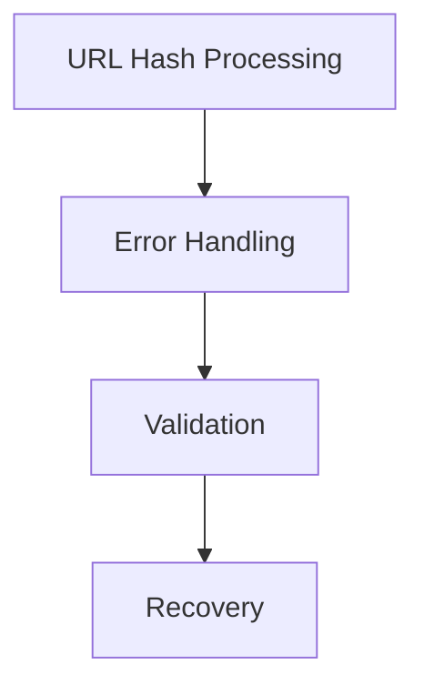
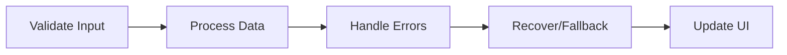

# Active Context

## Current Development Focus

### 1. Recent Code Changes

#### URL Hash Processing Improvements
- Split handling for SFIA and LoR sections (`&&` separator)
- Added validation for hash format
- Enhanced error recovery
- Improved logging for debugging

#### Error Handling Enhancements
- Added data validation checks
- Implemented graceful fallbacks
- Enhanced console messaging
- Added recovery mechanisms

### 2. Active Development Areas

#### Primary Focus
1. **Error Handling**
   - Input validation
   - Error recovery
   - User feedback
   - Debugging support

2. **State Management**
   - URL hash parsing
   - Data persistence
   - State synchronization
   - Browser compatibility

3. **User Experience**
   - Error messaging
   - Loading states
   - Responsive design
   - Accessibility

## Recent Decisions

### 1. Technical Decisions
- Implemented strict data validation
- Added comprehensive error logging
- Enhanced recovery mechanisms
- Improved code documentation

### 2. Implementation Approach

## Next Steps

### 1. Immediate Tasks
- [ ] Complete error handling implementation
- [ ] Test URL hash edge cases
- [ ] Document error scenarios
- [ ] Update user feedback

### 2. Upcoming Work
- [ ] Enhance mobile responsiveness
- [ ] Optimize performance
- [ ] Expand test coverage
- [ ] Update documentation

## Active Considerations

### 1. Code Quality
- Maintaining consistent error handling
- Ensuring code readability
- Following best practices
- Documenting changes

### 2. User Impact
- Minimizing disruption
- Providing clear feedback
- Ensuring data integrity
- Supporting all use cases

### 3. Technical Debt
- Identifying legacy patterns
- Planning refactoring
- Managing dependencies
- Improving maintainability

## Current Challenges

### 1. Technical Challenges
- Complex state management
- Browser compatibility
- Performance optimization
- Error recovery

### 2. Implementation Challenges
- Edge case handling
- Error scenario testing
- User experience consistency
- Cross-browser testing

## Documentation Updates

### 1. Code Documentation
- Added JSDoc comments
- Updated function descriptions
- Documented error scenarios
- Added usage examples

### 2. User Documentation
- Updated error messages
- Added troubleshooting guides
- Enhanced usage instructions
- Improved examples

## Testing Focus

### 1. Current Test Areas
- URL hash parsing
- Error handling
- State management
- UI updates

### 2. Test Scenarios
- Invalid URL formats
- Missing data
- Browser compatibility
- Error recovery

## Monitoring and Feedback

### 1. Performance Monitoring
- Load times
- Error rates
- User interactions
- State transitions

### 2. User Feedback
- Error reporting
- UI responsiveness
- Feature requests
- Bug reports

## Risk Management

### 1. Active Risks
- Data loss during errors
- Browser compatibility
- Performance impact
- User experience

### 2. Mitigation Strategies
- Comprehensive testing
- Graceful degradation
- Clear error messaging
- Performance monitoring

## Team Communication

### 1. Development Updates
- Daily progress
- Blocking issues
- Code reviews
- Testing results

### 2. Documentation
- Code changes
- Test coverage
- Known issues
- Future plans
