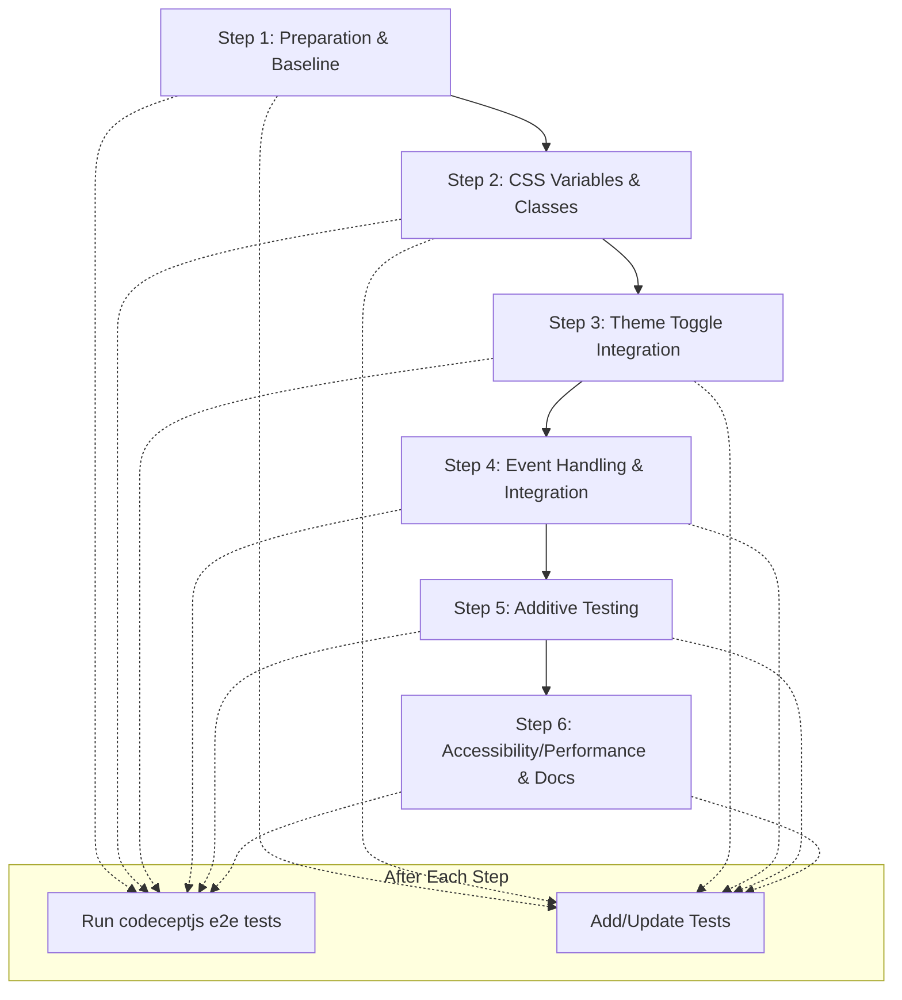

# CSS Modernization: Light-Dark Function Implementation

## 1. Legacy Approach: Dual Stylesheets

- **Files:** [`src/styles-light.css`](../src/styles-light.css:1), [`src/styles-dark.css`](../src/styles-dark.css:1)
- **Mechanism:** Two separate CSS files loaded based on user/system preference.
- **Drawbacks:** 
  - Code duplication
  - Harder maintenance
  - Slower theme switching

---

## 2. Intermediate Step: CSS Variables & Theme Classes

- **File:** [`src/styles.css`](../src/styles.css:1)
- **Actions:**
  - Introduce CSS custom properties for all themeable values.
  - Add theme classes (`.theme-dark`, `.theme-light`) and/or `[data-theme]` attributes.
  - Theme toggle logic in JS ([`src/modules/theme.mjs`](../src/modules/theme.mjs:1)).
- **Benefits:** 
  - Centralized theme logic
  - Easier to maintain and extend

---

## 3. Modern Approach: Single File with `light-dark()` Function

- **Goal:** Merge all color rules into a single CSS file using the `light-dark()` function.
- **How:** For each color property, combine the light and dark values:
  ```css
  color: light-dark(#222222, #f3f3f3);
  background: light-dark(#ffffff, #181a1b);
  ```
- **Remove:** No longer import or maintain separate light/dark CSS files.
- **Theme toggle:** Still supported via `[data-theme]` or class, but now only one CSS file.

---

## 4. Accessibility & Advanced Features

- **High Contrast:** Use `@media (prefers-contrast: high)` for overrides.
- **Reduced Motion:** Use `@media (prefers-reduced-motion: reduce)` for animations.
- **Print Styles:** Add print-specific rules for high-contrast output.
- **Validation:** 
  - Ensure all contrast ratios meet WCAG 2.1 AA.
  - Validate CSS syntax.
  - Test in all major browsers.

---

## 5. Migration Benefits

- **Single File:** Easier maintenance.
- **Performance:** No stylesheet switching.
- **Standards:** Modern CSS, future-proof.
- **Accessibility:** Improved support for user preferences.

---

## 6. Incremental Migration Workflow



---

## 7. Example: Migrating a Color Rule

**Before:**
```css
body {
  background: #ffffff; /* light */
  color: #222222;      /* light */
}
[data-theme="dark"] body,
.theme-dark body {
  background: #181a1b; /* dark */
  color: #f3f3f3;      /* dark */
}
```

**After:**
```css
body {
  background: light-dark(#ffffff, #181a1b);
  color: light-dark(#222222, #f3f3f3);
}
```

---

## 8. Next Steps

- Review all color-related rules and merge using `light-dark()`.
- Remove imports of old light/dark CSS files.
- Validate accessibility and cross-browser support.
- Document the migration and update developer guides.