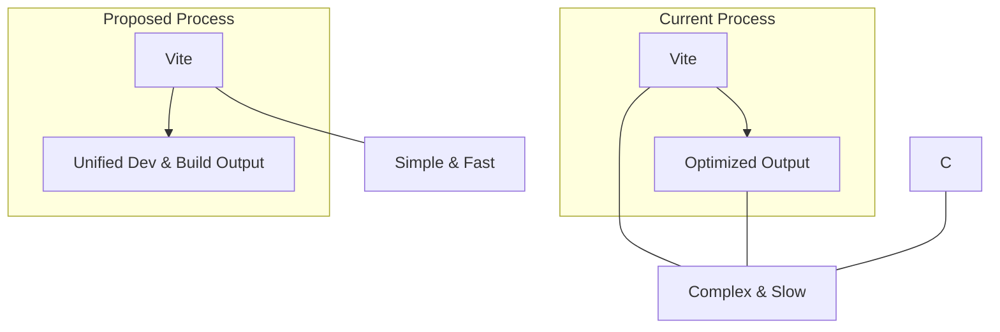

# Technical Proposal: Modernizing the Front-End Build Process

The build system has been successfully migrated to **Vite**, replacing the previous toolchain of Grunt, Rollup, and Webpack. This has resolved configuration conflicts and improved the developer workflow.

---

## 1. Step-by-Step Migration Plan to Vite

This plan will unify the build process, simplify configuration, and provide a superior development server.



### Step 1: Project Setup

- **Install Vite**:  
  ```sh
  npm install --save-dev vite
  ```
- **Remove Old Dependencies**:  
  The legacy dependencies (Grunt, Rollup, Webpack, etc.) have been removed.
  Remove any other build-related devDependencies that are no longer needed.

### Step 2: Create a Unified Entry Point

- Create `src/main.mjs` as the single entry point for the app.
- In `src/main.mjs`:
  ```js
  import { searchForText, exportHTML /*, ...other functions */ } from './modules/utilityFunctions.mjs';
  import './styles.css';

  // Expose legacy global functions for inline HTML handlers (temporary)
  window.searchForText = searchForText;
  window.exportHTML = exportHTML;
  // ...repeat for all required globals
  ```

### Step 3: Consolidate CSS

- Create `src/styles.css`:
  ```css
  @import './styles-light.css';
  @import './styles-dark.css';
  ```
  Vite will bundle these automatically.

### Step 4: Simplify `sfiapdgen.html`

- Keep CDN `<script>` tags for libraries (jQuery, Bootstrap, Ace, etc.).
- Remove `<link>` tags for `styles-light.css` and `styles-dark.css`.
- Replace any `<script type="module" src="modules/app.mjs"></script>` with:
  ```html
  <script type="module" src="/src/main.mjs"></script>
  ```

### Step 5: Configure Vite

- Create `vite.config.js` in the project root:
  ```js
  // vite.config.js
  import { defineConfig } from 'vite';

  export default defineConfig(({ mode }) => ({
    root: 'src',
    build: {
      outDir: mode === 'production' ? '../package/prd' : '../package/dev',
      emptyOutDir: true,
    },
    server: {
      open: '/sfiapdgen.html', // Automatically open the main HTML page
    },
  }));
  ```

### Step 6: Update `package.json` Scripts

Replace all build and dev scripts with Vite equivalents, and ensure all test scripts are preserved and work with the new structure:

```json
"scripts": {
  "dev": "vite",
  "build:dev": "vite build --mode development",
  "build:prd": "vite build --mode production",
  "preview": "vite preview",
  "test:unit": "jest",
  "test:unit:watch": "jest --watch",
  "test:unit:coverage": "jest --coverage",
  "test:unit:verbose": "jest --verbose",
  "test:export": "npx codeceptjs run ./test/ui/check_export_csv.local.test.js --steps --verbose",
  "testLocal": "npx codeceptjs run --config=codecept.local.conf.js && vite build --mode development",
  "codeceptjs": "codeceptjs run --steps",
  "codeceptjs:headless": "HEADLESS=true codeceptjs run --steps",
  "codeceptjs:ui": "codecept-ui --app",
  "start-server": "vite --port 5501",
  "stop-server": "taskkill /IM node.exe /F"
}
```
- `dev`: Starts the Vite development server.
- `build:dev` / `build:prd`: Creates development or production builds.
- `preview`: Preview the production build locally.
- All test scripts (`jest`, `codeceptjs`, etc.) are preserved and can be run independently of the build system.
- `testLocal` now runs CodeceptJS and then builds the dev bundle with Vite.

---

## 2. Build System Analysis

| Feature | Previous System (Webpack/Grunt) | Current System (Vite) |
|---|---|---|
| **Dev Server** | Slow startup, full bundle on every change. | Instant startup, HMR over native ES modules. |
| **Configuration** | Complex and explicit configuration. | Minimal and intuitive "zero-config" approach. |
| **Handling Legacy Code** | Handled via a complex plugin ecosystem. | Handled natively by Vite. |
| **Simplicity & Modernity**| Complex and dated. | Modern, simple, and designed for a better developer experience. |

---

## 3. Final Recommendation: Migrate to Vite

**Summary:**
- **Vite** provides a much simpler, faster, and more modern workflow.
- All build, dev, and preview tasks are unified under Vite.
- All test scripts (Jest, CodeceptJS) are preserved and run independently.
- Legacy global functions can be exposed as needed during migration.
- The developer experience and future maintainability are greatly improved.

**Action:**  
Adopt Vite as the sole build tool and remove all legacy build tools and configs. Update documentation and onboarding instructions accordingly.

---