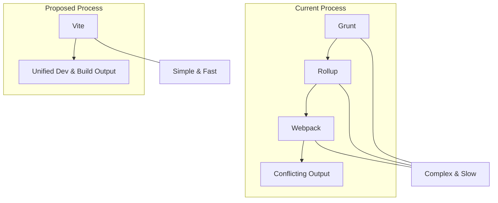

# Technical Proposal: Modernizing the Front-End Build Process

The current build system is a complex mix of Grunt, Rollup, and Webpack, leading to configuration conflicts and a slow developer workflow. This proposal outlines a plan to replace the entire toolchain with a single, modern tool: **Vite**.

## 1. Step-by-Step Migration Plan to Vite

This plan will unify the build process, simplify configuration, and provide a superior development server.



**Step 1: Project Setup**
-   **Install Vite**: Add Vite as a new development dependency.
-   **Remove Old Dependencies**: Uninstall Grunt, Rollup, Webpack, and all their related plugins (`grunt-contrib-clean`, `rollup-plugin-terser`, `webpack-cli`, `babel-loader`, etc.) from `package.json`.

**Step 2: Create a Unified Entry Point**
-   Create a new main script at `src/main.mjs`. This file will be the single entry point for the application's JavaScript.
-   Inside `src/main.mjs`, you will:
    1.  Import the main application logic from `app.mjs`.
    2.  Import a new main CSS file (e.g., `import './styles.css';`).
    3.  Explicitly attach the functions needed by the HTML's inline event handlers to the global `window` object. This is a temporary step to ensure compatibility until they are refactored.
        ```javascript
        // src/main.mjs
        import { searchForText, exportHTML /*, etc... */ } from './modules/utilityFunctions.mjs';
        import './styles.css'; // Import main CSS file

        // Expose necessary functions globally for legacy inline handlers
        window.searchForText = searchForText;
        window.exportHTML = exportHTML;
        // ... and so on for all other global functions
        ```

**Step 3: Consolidate CSS**
-   Create a new `src/styles.css` file.
-   Inside `styles.css`, import the existing light and dark themes:
    ```css
    /* src/styles.css */
    @import './styles-light.css';
    @import './styles-dark.css';
    ```
    Vite will automatically bundle these into a single CSS file for production.

**Step 4: Simplify `sfiapdgen.html`**
-   Keep the `<script>` tags that load libraries from CDNs (jQuery, Bootstrap, Ace, etc.) as Vite will preserve these by default.
-   Remove the `<link>` tags for `styles-light.css` and `styles-dark.css`.
-   Replace `<script type="module" src="modules/app.mjs"></script>` with a single script tag pointing to the new entry point:
    ```html
    <script type="module" src="/src/main.mjs"></script>
    ```

**Step 5: Configure Vite**
-   Create a `vite.config.js` file in the project root:
    ```javascript
    // vite.config.js
    import { defineConfig } from 'vite';

    export default defineConfig(({ command, mode }) => {
      return {
        // The root is where your index.html is located
        root: 'src',
        build: {
          // The output directory will be relative to the project root
          outDir: mode === 'production' ? '../package/prd' : '../package/dev',
          emptyOutDir: true, // Clean the directory before building
        },
      };
    });
    ```

**Step 6: Update `package.json` Scripts**
-   Replace the old scripts with new, simpler Vite commands:
    ```json
    "scripts": {
      "dev": "vite",
      "build:dev": "vite build --mode development",
      "build:prd": "vite build --mode production",
      "preview": "vite preview"
    }
    ```

## 2. Comparative Analysis: Webpack vs. Vite

This table compares the two leading tools in the context of this project's needs.

| Feature | Webpack | Vite | Winner for this Project |
| :--- | :--- | :--- | :--- |
| **Dev Server Performance** | Bundles all code before serving. HMR can be slow on large projects. | Serves source files over native ES modules. Near-instant server start and HMR. | **Vite** |
| **Build Speed** | Processes files through a loader pipeline. Can be slow. | Uses `esbuild` (written in Go) for bundling, which is 10-100x faster. | **Vite** |
| **Configuration** | Requires explicit, often complex configuration for everything. | "Zero-config" for common cases. Configuration is minimal and intuitive. | **Vite** |
| **Handling Legacy Code** | Excellent support for non-module scripts and complex dependencies via a vast plugin ecosystem. | Can handle non-module code, but may require more specific configuration or plugins. | Webpack (Slight edge) |
| **Simplicity & Modernity** | Can feel complex and dated. The de-facto standard for many years. | Designed from the ground up for modern JavaScript and a simple developer experience. | **Vite** |

## 3. Final Recommendation: Migrate to Vite

I strongly recommend **adopting Vite** for the build process.

**Justification:**
-   **Aligns with Priorities**: Vite is the embodiment of "Simplicity, Modern, and Optimization." It was created to solve the performance and configuration pain points of older tools like Webpack.
-   **Superior Developer Experience**: The speed of Vite's development server is a game-changer for productivity.
-   **Future-Proof**: Vite is built on modern web standards (like native ES modules) and provides the best foundation for the future refactoring you plan to do.
-   **Handles Legacy Needs**: While being thoroughly modern, Vite can still be configured to expose the global functions the application currently relies on, providing a smooth transition path.