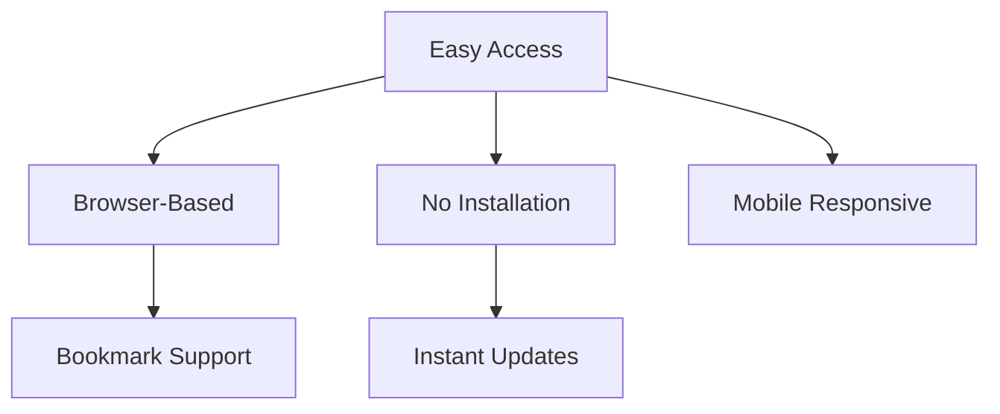
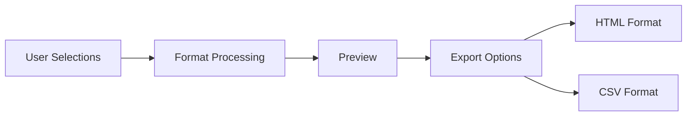

# Product Context

## Project Purpose

The SFIA Position Description (PD) Generator is a web-based tool designed to simplify the creation of job descriptions using the Skills Framework for the Information Age (SFIA). It addresses the challenge of creating standardized, comprehensive position descriptions that align with industry-recognized skill levels and responsibilities.

## Core Problems Solved

### 1. Standardization Challenge
- **Problem**: Inconsistent position descriptions across organizations
- **Solution**: Standardized framework based on SFIA skills and levels
- **Impact**: Improved hiring accuracy and role clarity

### 2. Skill Level Definition
- **Problem**: Difficulty in accurately defining required skill levels
- **Solution**: Pre-defined SFIA competency levels (1-7)
- **Impact**: Clear progression paths and expectations

### 3. Documentation Efficiency
- **Problem**: Time-consuming PD creation process
- **Solution**: Checkbox-based skill selection with automatic formatting
- **Impact**: Reduced time to create position descriptions

## User Experience Goals

### 1. Accessibility

### 2. Usability
- Intuitive checkbox-based selection
- Real-time preview of selections
- Simple export options (HTML/CSV)
- Dark/Light theme support
- Search functionality for skills

### 3. Efficiency
- Quick skill selection process
- Automated formatting
- State persistence via URL
- Bulk selection capabilities
- Rapid export options

## Core Functionality

### 1. SFIA Framework Integration
- Support for multiple SFIA versions (7, 8, 9)
- Comprehensive skill categories
- Detailed level descriptions
- Responsibility attributes

### 2. Selection Interface
- Checkbox-based skill selection
- Level-based competency choice
- Category organization
- Search and filter capabilities

### 3. Output Generation

## User Workflows

### 1. PD Creation Process
1. Browse/search SFIA skills
2. Select relevant competency levels
3. Review selections in real-time
4. Export formatted description

### 2. Reference Workflow
1. Load existing PD via URL
2. Review current selections
3. Modify as needed
4. Generate updated version

### 3. Template Usage
1. Create base PD template
2. Save via URL bookmark
3. Modify for specific roles
4. Export customized versions

## Integration Capabilities

### 1. AI Enhancement
- Cohere integration for content generation
- Hugging Face integration for analysis
- API key management
- Conversation capabilities

### 2. Export Options
- HTML formatting for web use
- CSV export for data processing
- Clipboard support
- Markdown editing capability

## Success Metrics

### 1. Usability Metrics
- Time to create PD
- Number of edits needed
- Export frequency
- Return usage rate

### 2. Quality Indicators
- Consistency with SFIA framework
- Completeness of descriptions
- Accuracy of level selections
- User satisfaction

## Future Enhancements

### 1. Content Enhancement
- Role templates
- Industry-specific presets
- Custom skill additions
- Batch processing

### 2. Integration Expansion
- HR system integration
- ATS compatibility
- Team collaboration
- Version control

### 3. User Experience
- Guided tutorials
- Advanced search
- Bulk operations
- Custom formatting

## Support and Maintenance

### 1. User Support
- Usage instructions
- Error handling
- Browser compatibility
- Mobile responsiveness

### 2. Content Updates
- SFIA version updates
- Framework changes
- Skill descriptions
- Level definitions

### 3. Technical Support
- Bug reporting
- Feature requests
- Performance monitoring
- Security updates
