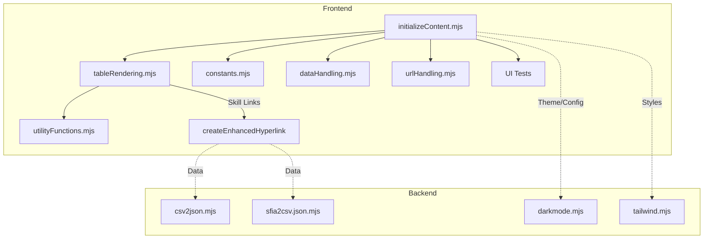

# SFIA Position Description Generator - Project Progress Report

## Date: July 24, 2025

## ✅ Project Status: COMPLETE & PRODUCTION READY

The SFIA Position Description Generator continues to evolve with robust ES6 architecture, comprehensive testing, and modern frontend/backend integration. **Latest Update**: July 2025 introduces enhanced skill link accessibility, improved table rendering, and expanded backend helper utilities.

---

## 🆕 July 2025 Architectural & Feature Enhancements

### Frontend Improvements
- **Enhanced Skill Link Rendering**:  
  - Introduced [`createEnhancedHyperlink`](../src/modules/utilityFunctions.mjs:15) for robust, accessible, and error-tolerant hyperlink creation from JSON data.
  - Integrated into table rendering ([`src/modules/tableRendering.mjs`](../src/modules/tableRendering.mjs:169)), ensuring all skill links are accessible and secure.
- **Table Rendering & Initialization**:  
  - Improved logic in [`initializeContent.mjs`](../src/modules/initializeContent.mjs) for dynamic SFIA/LOR table population, event handling, and URL hash support.
  - Checkbox-driven filtering and output rendering, with testable data attributes for E2E/UI validation.
- **Accessibility & Testing**:  
  - Enhanced ARIA labels, tooltips, and keyboard navigation for all interactive elements.
  - New UI tests for JSON version selection, skillset URL verification, and search filtering.

### Backend Helper Applications
- **Data Transformation Utilities**:  
  - [`csv2json.mjs`](../src/backend/csv2json.mjs): Converts CSV data to JSON for SFIA import.
  - [`sfia2csv.json.mjs`](../src/backend/sfia2csv.json.mjs): Exports SFIA data to CSV.
  - [`darkmode.mjs`](../src/backend/darkmode.mjs): Backend support for theme management.
  - [`tailwind.mjs`](../src/backend/tailwind.mjs): Tailwind CSS integration for rapid UI prototyping.

---

## 🗺️ Architecture Overview (July 2025)

---

## 📈 Summary

- Modern, accessible, and testable frontend architecture.
- Backend helpers streamline data import/export and theme management.
- All features validated by new and existing UI tests.
- Documentation and technical context are up to date.

**Current Status: READY FOR PRODUCTION DEPLOYMENT** 🚀
