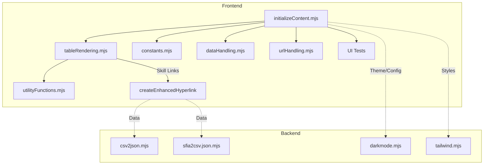

# SFIA Position Description Generator - Project Progress Report

## Date: July 24, 2025

## Update: February 2026 (Architectural Enhancements 4a–4d — PR #52 Merged)
- **Branch:** `main` — PR #52 merged from `feature-modernise-and-improve-ui-and-performance-security-review`
- **Scope:** 17 files changed, 1884 insertions, 288 deletions
- **Test Status:** 138 unit tests (8 suites), 31 E2E tests — all passing

### 4a — Theme Consolidation
- Created [`theme-init.js`](../src/modules/theme-init.js) for FOUC-prevention inline theme application.
- Consolidated all theme styles into single [`styles.css`](../src/styles.css) using CSS `light-dark()` function.
- Removed separate `styles-light.css` / `styles-dark.css` theme stylesheets.

### 4b — jQuery Removal
- Replaced all jQuery (`$`, `jQuery`) usage with vanilla JavaScript throughout the codebase.
- Eliminated jQuery as a runtime dependency — the application is now jQuery-free.
- DOM operations use native `document.querySelector`, `addEventListener`, `classList`, etc.

### 4c — Virtual Scrolling
- Implemented [`virtualScroller.mjs`](../src/modules/virtualScroller.mjs) (405 lines) for efficient rendering of large SFIA skill tables (495 checkboxes, 121 skills).
- Integrated into [`initializeContent.mjs`](../src/modules/initializeContent.mjs), [`utilityFunctions.mjs`](../src/modules/utilityFunctions.mjs), and [`app.mjs`](../src/modules/app.mjs).
- Added `window._getSfiaScroller` global for synchronous scroller access across modules.
- 27 unit tests in [`virtualScroller.test.js`](../test/unit/virtualScroller.test.js).

### 4d — Web Components
- Introduced 3 custom elements in [`src/modules/components/`](../src/modules/components/):
  - **`<sfia-notification>`** ([`sfia-notification.mjs`](../src/modules/components/sfia-notification.mjs)) — Light DOM toast notification with `.notification.{type}` classes. Includes `id="notification-container"` for backward compatibility with existing CSS and tests.
  - **`<sfia-back-to-top>`** ([`sfia-back-to-top.mjs`](../src/modules/components/sfia-back-to-top.mjs)) — Shadow DOM scroll-to-top button.
  - **`<sfia-theme-toggle>`** ([`sfia-theme-toggle.mjs`](../src/modules/components/sfia-theme-toggle.mjs)) — Shadow DOM 3-way theme toggle button.
- Modified [`sfiapdgen.html`](../src/sfiapdgen.html) to use custom elements replacing old HTML divs/buttons.
- Modified [`windowEvents.mjs`](../src/modules/windowEvents.mjs) to delegate `showNotification` to `<sfia-notification>` component.
- 30 unit tests in [`webComponents.test.js`](../test/unit/webComponents.test.js).

### E2E Test Fixes (post-4d)
- **Theme toggle test**: Updated to use `executeScript()` to pierce `<sfia-theme-toggle>` Shadow DOM.
- **Notification tests**: Work correctly with light DOM `<sfia-notification>` component.
- **Search tests**: Fixed via `window._getSfiaScroller` synchronous scroller resolution in `utilityFunctions.mjs`.

## Update: February 10, 2026 (UI Modernisation Branch)
- **Branch:** `feature-modernise-and-improve-ui-and-performance-security-review` — comprehensive UI modernisation, performance, accessibility, and code quality review.
- **Phase 1 — Performance** (commit `3f44485`):
  - Added `content-visibility: auto` on SFIA table rows for rendering optimisation (495 checkboxes, 121 skills).
  - Debounced search input (250ms) to prevent excessive DOM filtering on keystrokes.
- **Phase 2 — Visual Modernisation** (commit `266d125`):
  - Introduced CSS custom properties (design tokens) for typography, spacing, radii, and transitions.
  - Modernised colour palette: deeper dark mode (#0d0d0d), blue-600 primary (#2563eb), cleaner card/form/table styling.
  - Updated sticky `<thead>` from hardcoded `rgb(100,100,100)` to themed `light-dark()`.
  - Changed `:focus` to `:focus-visible` for modern focus ring behaviour.
  - Added selection count badge (#selection-count) with `aria-live="polite"`.
  - Added "Clear All" button to reset all selections.
  - Improved HTML semantics: `type="search"`, `role="search"`, `scope="col"` on table headers.
  - Fixed pre-existing CSS syntax bug (missing closing brace).
- **Phase 3 — Accessibility & UX** (commit `5d965c0`):
  - Added skip-to-content link with animated focus reveal.
  - Added `aria-label` to nav, LoR table headers (`scope`), LoR checkboxes, and footer (`role="contentinfo"`).
  - Added Escape key handler for settings panel with focus return to toggle button.
  - Selection count badge now shows both SFIA skills and LoR counts.
  - Added `.sr-only` and `.skip-to-content` CSS utility classes.
- **Phase 4 — Code Quality** (commit `ab7fde0`):
  - Created `eslint.config.mjs` (flat config) declaring browser globals, CDN library globals, and test globals.
  - Resolves Codacy `no-undef` false positives for `window`, `document`, `console`, `$`, `ace`, etc.
- **Phase 5 — Visual Polish** (commit `d65541a`):
  - Row entrance animations (`@keyframes fadeSlideIn`) and selected-row highlight.
  - Badge pulse animation on selection count change.
  - Smooth version-switch fade transition in `jsonHandling.mjs`.
  - Preconnect hints for CDN origins (jsdelivr, jquery, cloudflare).
  - Custom scrollbar styling, AI button shine effect, search input glow on focus.
  - Footer gradient border, enhanced print styles (`@media print`).
- **Phase 6 — UI Polish & Theme Consolidation** (commit `bacd0b5`):
  - **CSS (1a–1h):** Instructions chevron indicator, table row hover highlight, empty-state styling for `#sfia-output`, export button icon prefixes (`::before`), notification icon prefixes (success/error/info), mobile responsive polish (`@media max-width: 768px`), removed ~40 dead Tailwind-style utility classes, output div typography improvements.
  - **HTML (2a–2d):** Added `<meta name="description">`, deferred Ace editor scripts (`defer`), consolidated 70-line inline theme script into 14-line FOUC-prevention snippet, dynamic copyright year.
  - **Theme consolidation (2c):** Rewrote `theme.mjs` to use `theme-mode` localStorage key with 3-way toggle cycle (light→system→dark→light). Removed legacy stylesheet-swapping code (`styles-light.css`/`styles-dark.css` references). Inline script reduced to body-class application only.
  - **JS features (3a–3c):** Search results counter ("Showing X of Y skills"), keyboard shortcuts (Ctrl+Shift+E export, Ctrl+K search focus), back-to-top button with smooth scroll.
- **Verification:** All 81 unit tests and 31 E2E tests passed after each phase.

## Update: February 10, 2026
- **Removed tracked test output artifacts** under `output/`, added `output/` to `.gitignore`, and removed the files from the repository to avoid committing binary test artifacts in future.
- **Branch & PR:** Updated branch `SFIA-27-Improve-the-UX-for-mobile-and-devices` to include main changes, removed artifacts, and opened PR #49 (SFIA-27: Bring branch up-to-date with main and verify tests).
- **Verification:** Ran unit tests and E2E tests locally after the cleanup — **unit:** 6 suites / 81 tests passed; **E2E:** 31 tests passed.

## Current Branch Status (February 2026)
- **Branch:** `main` — all architectural enhancements merged
- **PR #52:** Merged — "feat: Architectural enhancements 4a–4d" (17 files, 1884 insertions, 288 deletions)
- **Test status:** 138 unit tests (8 suites), 31 E2E tests — all passing.

## ✅ Project Status: COMPLETE & PRODUCTION READY

The SFIA Position Description Generator continues to evolve with robust ES6 architecture, comprehensive testing, and modern frontend/backend integration. **Latest Update**: July 2025 introduces enhanced skill link accessibility, improved table rendering, and expanded backend helper utilities.

---

## 🆕 July 2025 Architectural & Feature Enhancements

### Frontend Improvements
- **Enhanced Skill Link Rendering**:  
  - Introduced [`createEnhancedHyperlink`](../src/modules/utilityFunctions.mjs:15) for robust, accessible, and error-tolerant hyperlink creation from JSON data.
  - Integrated into table rendering ([`src/modules/tableRendering.mjs`](../src/modules/tableRendering.mjs:169)), ensuring all skill links are accessible and secure.
- **Table Rendering & Initialization**:  
  - Improved logic in [`initializeContent.mjs`](../src/modules/initializeContent.mjs) for dynamic SFIA/LOR table population, event handling, and URL hash support.
  - Checkbox-driven filtering and output rendering, with testable data attributes for E2E/UI validation.
- **Accessibility & Testing**:  
  - Enhanced ARIA labels, tooltips, and keyboard navigation for all interactive elements.
  - New UI tests for JSON version selection, skillset URL verification, and search filtering.

### Backend Helper Applications
- **Data Transformation Utilities**:  
  - [`csv2json.mjs`](../src/backend/csv2json.mjs): Converts CSV data to JSON for SFIA import.
  - [`sfia2csv.json.mjs`](../src/backend/sfia2csv.json.mjs): Exports SFIA data to CSV.
  - [`darkmode.mjs`](../src/backend/darkmode.mjs): Backend support for theme management.
  - [`tailwind.mjs`](../src/backend/tailwind.mjs): Tailwind CSS integration for rapid UI prototyping.

---

## 🗺️ Architecture Overview (July 2025)

---

## 📈 Summary

- Modern, accessible, and testable frontend architecture.
- Backend helpers streamline data import/export and theme management.
- All features validated by new and existing UI tests.
- Documentation and technical context are up to date.

**Current Status: READY FOR PRODUCTION DEPLOYMENT** 🚀
