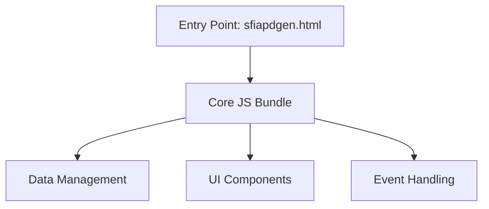
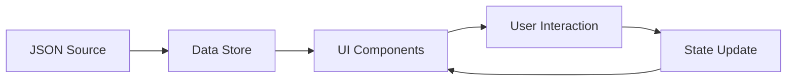

# System Architecture and Technical Patterns

## Core Architecture

### Build System
- **Primary Build Tool**: Hybrid Grunt + Webpack
- **Source Format**: ES6 modules (`.mjs`) + Legacy JavaScript (`.js`)
- **Development Output**: `package/dev/` (unminified, sourcemaps)
- **Production Output**: `package/prd/` (minified, optimized)
- **Legacy Support**: `.js` files maintained for backward compatibility
- **Future Direction**: Gradual migration to pure ES6 modules

### Operational Mechanics
- **Entry Points**: 
  - ES6 modules: `src/modules/*.mjs` bundled by Webpack
  - Legacy files: Concatenated by Grunt, included in HTML
- **Bundling Strategy**: 
  - Webpack bundles ES6 modules with Babel transpilation
  - Grunt concatenates legacy JavaScript files
  - Both outputs combined in final HTML
- **Transpilation**: Babel transpiles ES6+ code for browser compatibility
- **Asset Handling**: HTML, CSS, JSON, and static assets copied by Grunt
- **Sourcemaps**: Generated for development builds (both Grunt and Webpack)
- **Minification**: Enabled for production builds
- **Output Structure**:
  - `package/dev/`: Unminified JS, full sourcemaps, all assets
  - `package/prd/`: Minified JS, optimized assets, security headers

### Build Commands
```bash
npm run build:dev   # Development: Grunt concat + Webpack bundle
npm run build:prd   # Production: Grunt + Webpack + minification
```

### Critical Features Preserved from Legacy System
- Asset copying (HTML, CSS, JSON, images) - **Grunt**
- JavaScript concatenation for legacy files - **Grunt** 
- Minification and sourcemaps - **Grunt + Webpack**
- Environment-specific builds (dev/prod) - **Both**
- Content Security Policy for production - **Grunt**
- All legacy functionality mapped to modern equivalents

### Migration Strategy
- **Phase 1** ✅: ES6 infrastructure established (url handling, utilities)
- **Phase 2**: Gradually convert legacy `.js` files to `.mjs` modules  
- **Phase 3**: Full Webpack migration when all files are ES6
- **Backward Compatibility**: Legacy functions remain accessible during transition

### Application Structure

1. **Core Components**


2. **Source File Organization**:
- **Initialization**: 
  - `init.js`: Application bootstrap
  - `constants.js`: System constants
- **Data Layer**:
  - `dataFetching.js`: Data retrieval
  - `dataHandling.js`: Data processing
  - `jsonHandling.js`: JSON operations
- **UI Components**:
  - `checkboxHandling.js`: SFIA skill selection
  - `tableRendering.js`: Table generation
  - `exportFunctions.js`: Export capabilities
- **Core Utilities**:
  - `utilityFunctions.js`: Helper functions
  - `theme.js`: Theme management
- **Event Management**:
  - `eventListeners.js`: DOM events
  - `windowEvents.js`: Window-level events
  - `browserUpdate.js`: Browser compatibility

### External Dependencies
1. **Core Libraries**:
   - jQuery 3.7.1
   - Bootstrap 5.3.3
   - CryptoJS 4.1.1
   - Ace Editor 1.32.8

2. **Development Tools**:
   - Webpack for module bundling
   - CodeceptJS for testing
   - Grunt for build automation

## Design Patterns

### 1. Data Flow Pattern


### 2. Component Architecture
- **Data Components**: Handle SFIA and LoR data management
- **UI Components**: Manage user interface elements
- **Service Components**: Handle exports and data processing

### 3. State Management
- URL hash-based state persistence
- Local storage for theme preferences
- In-memory data store for runtime state

## Technical Decisions

1. **Browser Support**
   - Modern browsers (Chrome, Firefox) fully supported
   - Graceful degradation for older browsers
   - CSP headers in production for security

2. **Build Strategy**
   - Development: Concatenated files with sourcemaps
   - Production: Minified bundle with vendor dependencies
   - Separate CSS for light/dark themes

3. **Testing Approach**
   - UI Tests: CodeceptJS
   - Multiple test configurations (local, dist, production)
   - Automated test pipeline

## Integration Points

1. **External Services**
   - AI Integration (Cohere/Hugging Face)
   - Export functionality (CSV/HTML)

2. **Data Sources**
   - SFIA Framework versions (v7, v8, v9)
   - Levels of Responsibility data

## Known Technical Debt

1. **Build System**
   - Legacy Grunt configuration needs modernization
   - Potential migration to newer build tools

2. **Dependencies**
   - Some CDN dependencies could be localized
   - Version updates needed for security

3. **Code Organization**
   - Some functionality split across multiple files
   - Potential for better modularization

## Future Considerations

1. **Modernization Opportunities**
   - ES6+ module system adoption
   - Component-based architecture
   - Modern build tool migration

2. **Performance Improvements**
   - Bundle size optimization
   - Lazy loading of features
   - Caching strategies

3. **Security Enhancements**
   - CSP implementation review
   - API key management improvements
   - Input validation strengthening
