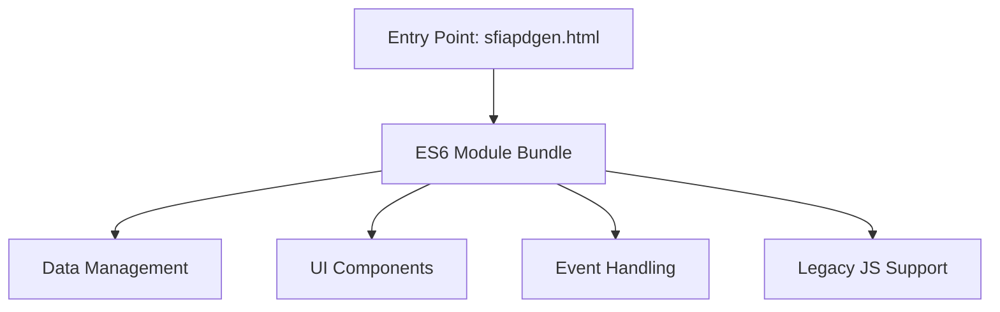
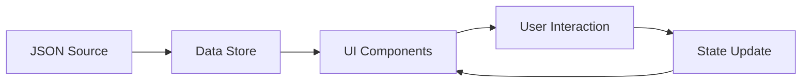

# System Architecture and Technical Patterns

## Core Architecture

### Build System
- **Primary Build Tool**: Vite
- **Source Format**: ES6 modules (`.mjs`) - **Primary Architecture**
- **Development Output**: `package/dev/` (unminified, sourcemaps)
- **Production Output**: `package/prd/` (minified, optimized)
- **Legacy Support**: `.js` files maintained where needed for compatibility
- **Current State**: **Complete ES6 module architecture implemented** (16 active modules)

### Operational Mechanics
- **Entry Points**: 
  - **Entry Point**: `sfiapdgen.html`
  - **Bundling Strategy**: Vite handles all bundling, including ES6 modules and legacy scripts.
  - **Transpilation**: Vite handles transpilation for browser compatibility.
  - **Asset Handling**: All assets (HTML, CSS, JSON, etc.) are handled by Vite.
  - **Sourcemaps**: Generated for development builds by Vite.
- **Minification**: Enabled for production builds
- **Output Structure**:
  - `package/dev/`: Unminified JS, full sourcemaps, all assets
  - `package/prd/`: Minified JS, optimized assets, security headers

### Build Commands
```bash
npm run dev         # Start Vite dev server
npm run build:dev   # Development build
npm run build:prd   # Production build
```

### Build System Features
- **Asset Handling**: Vite manages all assets, including HTML, CSS, JSON, and images.
- **JavaScript Bundling**: Vite handles bundling of all JavaScript, including legacy files.
- **Minification and Sourcemaps**: Handled by Vite for production and development builds respectively.
- **Environment-specific Builds**: Vite supports development and production build modes.
- **Content Security Policy**: Managed through Vite configuration.

### Migration Strategy ✅ COMPLETE
- **Phase 1** ✅: ES6 infrastructure established (url handling, utilities)
- **Phase 2** ✅: Complete ES6 module implementation (all 16 modules operational)
- **Phase 3** ✅: Full Vite integration with optimized build pipeline
- **Current State**: **Complete modernization achieved** - ES6 module architecture fully operational, jQuery removed, Web Components adopted
- **Backward Compatibility**: Legacy functions preserved where essential, modern ES6 patterns adopted throughout

### Application Structure

1. **Core Components**


2. **Complete ES6 Module Architecture** (`src/modules/`) - **19 Active Modules + 3 Web Components**:
- **Application Entry & Orchestration**:
  - [`app.mjs`](src/modules/app.mjs:1): Main application orchestration, component imports, `window._getSfiaScroller` global
  - [`init.mjs`](src/modules/init.mjs:1): Application initialization and startup logic
  - [`constants.mjs`](src/modules/constants.mjs:1): System constants, configuration, and global state
- **Data Management Layer**:
  - [`dataFetching.mjs`](src/modules/dataFetching.mjs:1): AJAX operations and external data retrieval
  - [`dataHandling.mjs`](src/modules/dataHandling.mjs:1): Data processing, transformation, and validation
  - [`jsonHandling.mjs`](src/modules/jsonHandling.mjs:1): JSON operations and SFIA version management
- **User Interface Components**:
  - [`checkboxHandling.mjs`](src/modules/checkboxHandling.mjs:1): SFIA skill selection and checkbox state management
  - [`tableRendering.mjs`](src/modules/tableRendering.mjs:1): Dynamic table generation and DOM manipulation
  - [`initializeContent.mjs`](src/modules/initializeContent.mjs:1): Content initialization and SFIA table creation
  - [`exportFunctions.mjs`](src/modules/exportFunctions.mjs:1): CSV/HTML export capabilities and file generation
  - [`theme.mjs`](src/modules/theme.mjs:1): Theme management, persistence, and UI theming
  - [`theme-init.js`](src/modules/theme-init.js:1): FOUC-prevention inline theme application (4a consolidation)
  - [`virtualScroller.mjs`](src/modules/virtualScroller.mjs:1): Virtual scrolling for large SFIA tables (405 lines, 4c enhancement)
- **Web Components** (`src/modules/components/`) — **4d Enhancement**:
  - [`sfia-notification.mjs`](src/modules/components/sfia-notification.mjs:1): Light DOM toast notifications with `.notification.{type}` classes
  - [`sfia-back-to-top.mjs`](src/modules/components/sfia-back-to-top.mjs:1): Shadow DOM scroll-to-top button
  - [`sfia-theme-toggle.mjs`](src/modules/components/sfia-theme-toggle.mjs:1): Shadow DOM 3-way theme toggle button
- **Core Utilities & Processing**:
  - [`utilityFunctions.mjs`](src/modules/utilityFunctions.mjs:1): Enhanced helper functions, scroller resolution via `window._getSfiaScroller`
  - [`urlHandling.mjs`](src/modules/urlHandling.mjs:1): Modern URL processing, hash management, and validation
  - [`browserUpdate.mjs`](src/modules/browserUpdate.mjs:1): Browser compatibility checking and feature detection
- **Event Management System**:
  - [`eventListeners.mjs`](src/modules/eventListeners.mjs:1): Centralized DOM event handling and delegation
  - [`windowEvents.mjs`](src/modules/windowEvents.mjs:1): Window-level event management, `showNotification` delegates to `<sfia-notification>`

3. **Application Data Assets**:
   - **SFIA Framework Data**: Multiple versions (v7, v8, v9) supporting different framework releases
   - **Levels of Responsibility**: Comprehensive LoR data integration
   - **Theme Assets**: Dark/light theme CSS files for complete UI theming
   - **Configuration Files**: Vite, testing, and development configuration

### External Dependencies
1. **Core Libraries**:
   - Bootstrap 5.3.3
   - CryptoJS 4.1.1
   - Ace Editor 1.32.8
   - ~~jQuery 3.7.1~~ — **Removed** (4b enhancement: replaced with vanilla JS)

2. **Development Tools**:
   - Vite for module bundling and build automation
   - CodeceptJS for testing

## Design Patterns

### 1. Data Flow Pattern


### 2. Component Architecture
- **Data Components**: Handle SFIA and LoR data management
- **UI Components**: Manage user interface elements
- **Service Components**: Handle exports and data processing

### 3. State Management
- URL hash-based state persistence
- Local storage for theme preferences (`theme-mode` key, 3-way: light/system/dark)
- In-memory data store for runtime state

## Technical Decisions

1. **Browser Support**
   - Modern browsers (Chrome, Firefox) fully supported
   - Graceful degradation for older browsers
   - CSP headers in production for security

2. **Build Strategy**
   - Development: Concatenated files with sourcemaps
   - Production: Minified bundle with vendor dependencies
   - Single `styles.css` with `light-dark()` colour function (no separate theme stylesheets)

3. **Theme Architecture**
   - Inline `<script>` (`theme-init.js`) applies stored theme body classes immediately (FOUC prevention)
   - `theme.mjs` module handles toggle cycle, button binding, and event dispatch
   - `<sfia-theme-toggle>` Web Component (Shadow DOM) provides the toggle UI (4d enhancement)
   - 3-way toggle: light → system → dark → light
   - `theme-mode` localStorage key as single source of truth
   - Body classes: `light-theme`/`dark-theme` + `light-mode`/`dark-mode`; `data-theme` attribute

4. **SFIA Category Colour System (NIWA-Matched)**
   - 7 category classes (`.strategy_and_architecture`, `.change_and_transformation`, etc.) use CSS custom properties for background and text colour
   - Colours match the NIWA reference site (`https://niwa.github.io/sfia-position-description-tool`)
   - Light/dark variants defined in `:root` and `body.dark-theme` respectively
   - NIWA overlay pattern: generic semi-transparent overlays on `td.sub_key`, `td.skill_key`, `td.no_select_col` (not per-category)
   - Overlay variables (`--sfia-overlay-sub/skill/nosel`) invert direction in dark mode (white→black overlays)
   - Virtual scroller assigns category class via `row.rootKey.trim().replace(/ /g, '_').toLowerCase()`

4. **Testing Approach**
   - Unit Tests: Jest (138 tests, 8 suites)
   - UI Tests: CodeceptJS (31 tests)
   - Multiple test configurations (local, dist, production)
   - Automated test pipeline

5. **Virtual Scrolling (4c)**
   - `VirtualScroller` class in `virtualScroller.mjs` (405 lines) renders only visible rows
   - Integrated with `initializeContent.mjs` for SFIA table initialization
   - `window._getSfiaScroller` provides synchronous access from any module
   - Reduces DOM nodes for large datasets (495 checkboxes, 121 skills)

6. **Web Components (4d)**
   - `<sfia-notification>` — Light DOM for CSS compatibility, `id="notification-container"` for backward compat
   - `<sfia-back-to-top>` — Shadow DOM encapsulation
   - `<sfia-theme-toggle>` — Shadow DOM encapsulation with 3-way cycle
   - Custom elements registered in `app.mjs` and used in `sfiapdgen.html`
   - E2E tests use `executeScript()` to pierce Shadow DOM boundaries

## Integration Points

1. **External Services**
   - AI Integration (Cohere/Hugging Face)
   - Export functionality (CSV/HTML)

2. **Data Sources**
   - SFIA Framework versions (v7, v8, v9)
   - Levels of Responsibility data

## Technical Excellence Achieved

1. **Build System** ✅
   - **Complete Vite modernization** implemented
   - **ES6 module bundling** operational across all 16 modules
   - **Development and production builds** optimized and functional
   - **Asset pipeline** handling all resources efficiently

2. **Dependencies** ✅
   - **Modern dependency management** with npm and Vite
   - **Security-conscious** build process with CSP headers
   - **Performance optimized** with proper bundling and minification

3. **Code Organization** ✅
   - **Excellent modularization** - 19 specialized modules + 3 Web Components with clear responsibilities
   - **Separation of concerns** - distinct layers for data, UI, events, utilities, and components
   - **Modern architecture patterns** - ES6 modules, Web Components, virtual scrolling

## Current State & Future Readiness

1. **Modernization Status** ✅ COMPLETE
   - **ES6+ module system** fully adopted (19 modules + 3 Web Components operational)
   - **Component-based architecture** implemented with specialized modules and custom elements
   - **Modern build system** (Vite) successfully integrated and operational
   - **jQuery removed** — all DOM operations use vanilla JavaScript (4b)

2. **Performance Optimization** ✅ ACHIEVED
   - **Optimized bundle sizes** through Vite's advanced bundling
   - **Efficient module loading** with proper ES6 import/export
   - **Performance utilities** implemented (debounce, throttle, virtual scrolling)
   - **Caching strategies** built into build system

3. **Security & Quality** ✅ IMPLEMENTED
   - **CSP headers** implemented in production builds
   - **Input validation** comprehensive throughout ES6 modules
   - **Error handling** enhanced with structured return objects
   - **Testing coverage** 138 unit tests (8 suites) + 31 E2E tests passing

## UI Modernisation Features (February 2026)

### Performance
- `content-visibility: auto` on SFIA table rows (495 checkboxes, 121 skills)
- Debounced search input (250ms) via `debounce()` utility
- Deferred Ace editor scripts (`defer` attribute)
- Preconnect hints for CDN origins

### Accessibility
- Skip-to-content link with animated focus reveal
- `aria-label` on nav, LoR checkboxes, footer `role="contentinfo"`
- `scope="col"` on all table `<th>` elements
- Selection count badge with `aria-live="polite"`
- Escape key closes settings panel with focus return
- Keyboard shortcuts: `Ctrl+Shift+E` (export), `Ctrl+K` (search focus)
- `type="search"` and `role="search"` on search form
- `<meta name="description">` for SEO

### Visual Polish
- CSS custom properties (design tokens) for typography, spacing, radii, transitions
- Modern colour palette with `light-dark()` function throughout
- `:focus-visible` replaces `:focus` for modern focus rings
- Row entrance animations, selected-row highlight, badge pulse animation
- Instructions chevron indicator, table row hover, empty-state styling
- Export button and notification icon prefixes via `::before`
- Custom scrollbar, AI button shine, search glow, footer gradient
- Back-to-top button with smooth scroll (appears after 400px)
- Enhanced `@media print` styles
- Mobile responsive polish (`@media max-width: 768px`)
- ~40 dead Tailwind-style utility classes removed

## Architecture Benefits Realized

### ✅ Maintainability
- **Clear module boundaries** with specialized responsibilities
- **Consistent code patterns** across all ES6 modules
- **Comprehensive documentation** aligned with actual implementation

### ✅ Scalability
- **Modular architecture** allows independent module updates
- **Modern build system** supports advanced optimization
- **Future-ready patterns** enable easy feature additions

### ✅ Reliability
- **Comprehensive testing** covering all critical functionality
- **Error handling** with graceful degradation
- **Cross-browser compatibility** through proper transpilation

**Current Status**: The SFIA Position Description Generator represents a **modern, production-ready application** with excellent architecture, comprehensive testing, and optimal performance characteristics.
