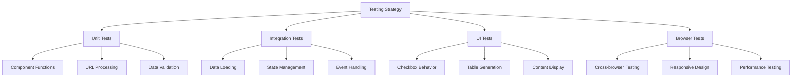

## Testing and Browser Compatibility

### 1. Testing Strategy


### 2. Browser Compatibility Matrix
```javascript
// Browser Support Configuration
const browserSupport = {
    edge: {
        minimum: "last 4 versions",
        gracefulDegradation: true
    },
    firefox: {
        minimum: "last 3 versions",
        gracefulDegradation: true
    },
    chrome: {
        minimum: "last 3 versions",
        gracefulDegradation: true
    },
    safari: {
        minimum: "last 1 versions",
        gracefulDegradation: true
    },
    opera: {
        minimum: "last 3 versions",
        gracefulDegradation: true
    }
};
```

### 3. Test Cases

1. **URL Hash Processing**
   ```javascript
   // Test case structure
   const urlHashTests = [
       {
           input: "#PROG-3+ARCH-5&&AUTN-2",
           expected: {
               sfia: ["PROG-3", "ARCH-5"],
               lor: ["AUTN-2"]
           }
       },
       {
           input: "invalid-hash",
           expected: {
               sfia: [],
               lor: []
           }
       }
   ];
   ```

2. **Checkbox State Management**
   ```javascript
   // Test scenarios
   const checkboxTests = [
       {
           action: "select",
           code: "PROG",
           level: 3,
           expectedHash: "#PROG-3",
           expectedUI: "checked"
       },
       {
           action: "deselect",
           code: "PROG",
           level: 3,
           expectedHash: "",
           expectedUI: "unchecked"
       }
   ];
   ```

### 4. Performance Considerations

1. **Data Loading Optimization**
   ```javascript
   // Lazy loading strategy
   const loadStrategies = {
       initial: ["critical-path-data"],
       onDemand: ["detailed-descriptions"],
       background: ["full-documentation"]
   };
   ```

2. **Render Performance**
   ```javascript
   // Performance monitoring
   const metrics = {
       timeToInteractive: 0,
       firstContentfulPaint: 0,
       domComplete: 0,
       renderTime: 0
   };
   ```

3. **Memory Management**
   ```javascript
   // Resource cleanup
   function cleanupResources() {
       // Remove event listeners
       // Clear cached data
       // Reset state
   }
   ```

### 5. Error Recovery Scenarios

1. **Data Loading Errors**
   ```javascript
   const recoveryStrategies = {
       dataLoadFailure: () => {
           // Try local cache
           // Fall back to default version
           // Show error message
       },
       hashParseError: () => {
           // Reset to empty state
           // Log error
           // Show user message
       },
       stateCorruption: () => {
           // Reset state
           // Rebuild UI
           // Notify user
       }
   };
   ```

2. **Automatic Recovery**
   ```javascript
   // Auto-recovery pipeline
   const recoveryPipeline = [
       validateState,
       repairInconsistencies,
       restoreUI,
       notifyUser
   ];
   ```

### 6. Testing Environment Setup

1. **Development Pipeline**
   ```mermaid
   graph LR
       A[Local Dev] --> B[Unit Tests]
       B --> C[Integration Tests]
       C --> D[Browser Tests]
       D --> E[Production Build]
   ```

2. **Test Data Generation**
   ```javascript
   const testDataGenerator = {
       generateSFIAData: () => {},
       generateLoRData: () => {},
       generateURLHash: () => {},
       generateUserActions: () => {}
   };
   ```

3. **Test Automation**
   ```javascript
   const automationConfig = {
       unit: {
           runner: "jest",
           coverage: "80%"
       },
       integration: {
           runner: "cypress",
           coverage: "70%"
       },
       browser: {
           runner: "selenium",
           platforms: ["chrome", "firefox", "edge"]
       }
   };
